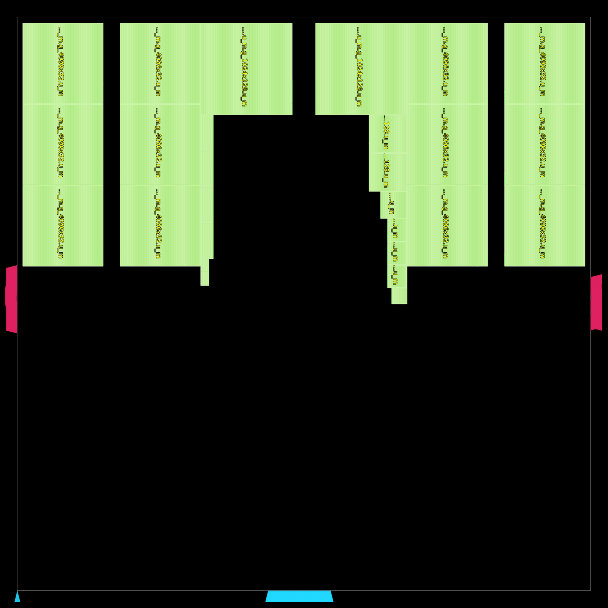
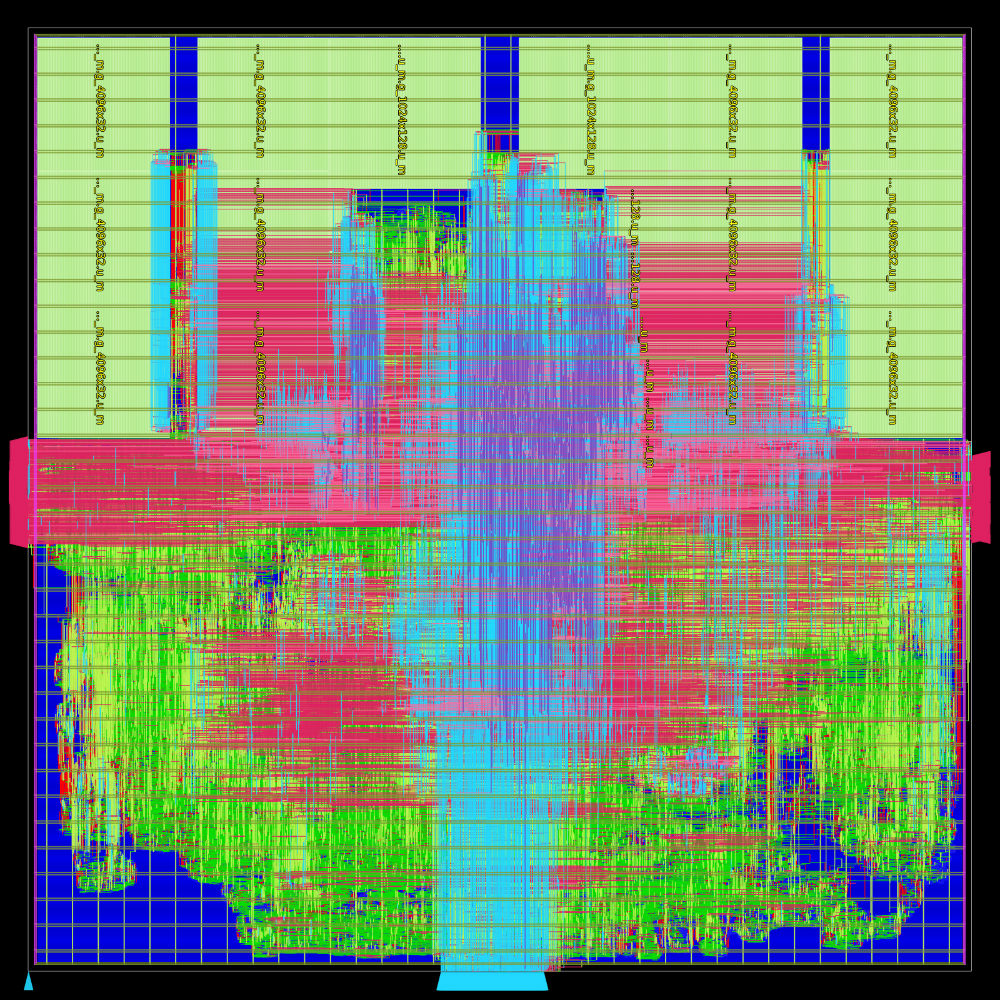

# nangate45-small with planned macro placement (OpenLayout)

A second physical-design flow for the ASIC block (`rtl/asic/otpu_asic_top.sv`, design point
nangate45-small: `asic/nangate45/README.md`), next to `tools/asic/flow.py`'s ORFS flow. It asks a
different question: how far a denser floorplan goes when the macros are placed by plan instead of
by the automatic macro placer.

| | `tools/asic/flow.py` (ORFS) | this flow |
|---|---|---|
| utilization | 35% | 60% (die 2.05 x 2.05 mm = 4.20 mm² against 7.02 mm²) |
| clock asked | 2.5 ns | 3.3 ns |
| synthesis | ORFS, hierarchical | Yosys, flat (`scripts/synth.tcl`: ORFS's flat recipe as one script) |
| macro placement | `rtl_macro_placer`, 10 um halo, 60 um channels | planned candidates (OpenLayout's planner and checker skills), 3 um halo |
| place, CTS, route | ORFS | OpenROAD scripts from OpenLayout's templates (`scripts/pnr.tcl`) |

[OpenLayout](https://github.com/fenggev56/OpenLayout) is a multi-agent physical-design framework
on OpenROAD: a Planner places macros from written rules (`skills/skills_Nangate45/1.macro_place/
SKILL_planner.md`: macros on the periphery, pin sides inward, no narrow channels, the area next to
the I/O pin groups left to standard cells, clustered macros together), a Checker passes or fails
the placement on an image with the macros' pin sides marked (Gate A, `SKILL_checker.md`), and the
placement then goes through fixed placement / CTS / routing templates. Here the three candidates
were planned and checked that way and are kept as code (`candidates/gen_candidates.py`).

## Run

```
git clone https://github.com/fenggev56/OpenLayout.git      # the dataflow code (a532f72 here)
export OPENLAYOUT_HOME=$PWD/OpenLayout
export ORFS_HOME=...            # an OpenROAD-flow-scripts checkout (its nangate45 platform files)
export YOSYS=... YOSYS_SLANG=... OPENROAD=...   # defaults: yosys, slang, openroad on PATH
asic/nangate45/openlayout/run.sh all cand2      # prep, synth, floorplan, dataflow, macro, pnr, snapshot
asic/nangate45/openlayout/run.sh macro cand1    # one step, one candidate (cand1 cand2 cand3)
asic/nangate45/openlayout/run.sh baseline       # rtl_macro_placer with its defaults, as "rtlmp"
asic/nangate45/openlayout/run.sh pnr rtlmp
OL_TIMING_DRIVEN=1 asic/nangate45/openlayout/run.sh pnr cand2   # timing-driven placement
```

`skills/` is a copy of OpenLayout's skills at a532f72 (GPL-3.0, `skills/LICENSE`; the rest of
this repository stays Apache-2.0): `run.sh` takes the pin-side image tool
(`skills/skills_Nangate45/macro_pin_side`) and the snapshot template
(`skills/skills_openroad_flow/image_snapshot`) from there (`OL_SKILLS` names another copy). Only
the dataflow step needs an OpenLayout checkout (`OPENLAYOUT_HOME`: its `dataflow/rtlmp/run.py`);
synthesis, the floorplan, `macro` and `pnr` need only this directory.

Everything goes to `build/asic/small-openlayout/` (`OL_WORK`): `synth/`, `floorplan.odb`,
`dataflow/`, `<cand>/macro_placed.odb`, `<cand>/reports/` (checkpoints per stage, `ppa_<stage>.txt`,
power, clock skew, the worst paths, the DRC report), `<cand>/images/`. The run here used Yosys 0.69
with yosys-slang and OpenROAD v2.0-17598; placement to routed takes 2.7 to 3.6 hours on 8 threads (cand1: 8 hours) and
21 GB (synthesis 21 minutes).

## Steps

- **prep**: `tools/asic/flow.py prep small` (the 27 macros' LEF / Liberty, the macro map).
- **synth**: yosys-slang elaborates the block with the point's parameters; `scripts/synth.tcl`
  is ORFS's flat synthesis for nangate45 (the macros black boxes, the small asynchronous-read
  RAMs flip-flops). 524,842 cells, 1.113 mm², 27 macros (1.308 mm²).
- **floorplan**: 60% utilization, aspect ratio 1, 20 um core margin; the I/O pins on the left,
  bottom and right edges (the placer groups them at mid height left and right and at the middle
  of the bottom edge), the top edge free.
- **dataflow**: OpenLayout's RTL-MP clustering of the netlist (`results/opentpu_asic_small_macro_clusters.txt`:
  8 macro clusters: TMEM 12, IMEM 2, DMA 2, ACT 4 + 2, MXU 3 + 1 + 1).
- **macro**: a candidate's `place_macro` commands on the floorplan, an overlap / core check, and
  the Gate-A image (`<cand>/images/`: red bar = a macro's pin side, cyan = I/O).
- **pnr** (`scripts/pnr.tcl`): macros fixed with a 3 um placement halo, PDN (M1 rails, thin M4
  straps, M9 stripes, M9 / M10 ring), global placement, repair, routability placement,
  legalization, repair again (the second placement moves every cell), CTS, setup and hold repair,
  global route, repair on the routed parasitics, global route, detailed route. After CTS the
  ports' virtual clock gets the tree's insertion delay as latency (`constraint.sdc`), so the port
  paths are neither charged nor credited it.

## Candidates

Every macro has its pins on the left edge, so the plans use R0 (pins left) and MY (pins right).
Each went through Gate A twice: the first plans put macros beside the I/O pin groups or left
fragments in the standard-cell region; the second passed.

| | plan |
|---|---|
| cand1 | top band: TMEM in 2 rows of 6 on the top edge (one copy around each pin channel), IMEM, ACT, MXU FIFOs and DMA in a partial third row that leaves the channel mouths open |
| cand2 | two corner blocks: TMEM as 2 columns x 3 rows in each top corner (pins into a 60 um channel), IMEM between them pin to pin, ACT and DMA / MXU FIFOs in columns on the blocks' inner backs |
| cand3 | three corners: one TMEM copy (2 x 2) in the top left, top right and bottom right corner, IMEM between the top blocks, ACT on the bottom right block's back |
| rtlmp | the baseline: `rtl_macro_placer` with no options |

cand2, the whole-die snapshot of the macro placement (`run.sh snapshot`, OpenLayout's
image_snapshot skill):



## Results

**3.3 ns, cand2** (`results/cand2_3p3ns/`): routed, no DRC violations, timing met on the flow's
global-route parasitics (setup -0.05 ns on extracted parasitics: below).

| | |
|---|---|
| setup | worst slack +0.156 ns, no violating endpoint |
| hold | worst slack +0.051 ns, no violating endpoint |
| DRC | 0 violations after detailed routing (9 passes) |
| instances | 523,917 standard cells (1.227 mm²), 27 macros (1.308 mm²): 63% of the core |
| wire | 14.03 m, 4.06 M vias |
| clock skew | 0.13 ns (insertion delay 0.92 to 1.05 ns) |
| power | 0.555 W at 3.3 ns, vectorless: sequential 0.218, clock 0.133, macros 0.121, combinational 0.083 |

This result is the 3.0 ns run's placement and clock tree (below) routed and repaired under
`constraint.sdc`'s 3.3 ns: the first runs asked 3.0 ns throughout, and the one clock change was
made at the routing stage. Timing after detailed routing is on global-route parasitics
(`estimate_parasitics -global_routing`), not an extraction.



`results/cand2_3p3ns/` keeps the routed database's SDC (`otpu_asic_top_routed.sdc`: the 3.3 ns clock
and the virtual clock's 0.62 ns latency) and the setup / hold paths the flow reported
(`setup_route.txt`, `hold_route.txt`). The routed database itself (89 MB as .xz, 713 MB unpacked,
written by OpenROAD v2.0-17598) is not kept in the repository, to keep clones small: `run.sh pnr
cand2` writes one to `build/asic/small-openlayout/cand2/reports/otpu_asic_top_routed.odb`.

**Extracted timing.** The ODB keeps the detailed routes, not the global-route guides the numbers
above come from (`estimate_parasitics -global_routing` on the ODB alone misses most nets). With the
routed wires extracted (OpenRCX, ORFS's `nangate45/rcx_patterns.rules`, OpenROAD 26Q3-173) the
3.3 ns run is just short: setup worst slack **-0.05 ns, 31 endpoints, TNS -0.54 ns** (the worst in the
VPU's `u_ma` adder, `u_slice.u_vpu.g_lane[0].g_slot[3]`), hold +0.04 ns with no violation. Steps
(the extraction takes about 4 minutes on 16 threads):

```
openroad -no_init -threads 16
  read_db build/asic/small-openlayout/cand2/reports/otpu_asic_top_routed.odb
  define_corners tt
  read_liberty -corner tt $::env(PLATFORM_DIR)/lib/NangateOpenCellLibrary_typical.lib
  foreach f [glob build/asic/small/macros/*.lib] { read_liberty -corner tt $f }   ;# run.sh prep
  read_sdc asic/nangate45/openlayout/results/cand2_3p3ns/otpu_asic_top_routed.sdc
  define_process_corner -ext_model_index 0 X
  extract_parasitics -ext_model_file $::env(PLATFORM_DIR)/rcx_patterns.rules
  report_worst_slack -max; report_worst_slack -min; report_tns
```

`openroad -gui` and `read_db` open it for viewing.

**3.0 ns, the four placements** (the same scripts, 3.0 ns asked from synthesis on):

| | cand1 | cand2 | cand3 | rtlmp |
|---|---|---|---|---|
| placement HPWL | 11.92 m | 11.90 m | 11.41 m | 11.09 m |
| setup WNS after CTS | -0.012 ns | -0.125 ns | -0.078 ns | -0.098 ns |
| global route | 2768 overflow left | 0 overflow | 0 overflow | 0 overflow |
| setup WNS, routed | -0.344 ns (35 endpoints) | -0.107 ns (219) | -0.128 ns (294) | -0.013 ns (9), global route |
| hold WNS | +0.049 ns | +0.051 ns | +0.051 ns | +0.052 ns |
| DRC violations | 0 | 0 | 0 | 16,354 after 20 passes (not converging) |
| routed wire | 15.42 m | 14.03 m | 13.50 m | |
| run time (8 threads) | 8 h 17 min | 3 h 35 min | 2 h 42 min | 10 h 20 min |

- The worst paths are the ones `docs/asic.md` names, and none has a macro on it: VPU `ic` -> the
  arbitration -> the quantizer's fadd stage (45 cells, 33 of them buffers: wire), the slice's
  `rl_pend` -> the VPU's registers, DMA -> quantizer. At 60% the die is 2.05 mm and these cross it.
- The automatic placement times best and routes worst: it spreads the macros over all four edges
  (the standard cells keep a nearly square region, 1.60 x 1.47 mm, and the shortest wirelength),
  but its detailed routing stays at 16 K violations (shorts, mostly): it abuts macros on a pin
  side (two MXU FIFOs, two ACT pairs, two TMEM pairs: `images/opentpu_asic_small_rtlmp_macro_place.png`, macros 9 / 10,
  2 / 5, 18 / 22, 19 / 23), and the violations are at those macros' pins. The planned candidates route clean; the top
  band (cand1) squeezes the cells into 1.71 x 1.21 mm and congests.
- At the routing stage nothing closed 3.0 ns on cand2: resistance-aware routing of the critical
  nets (`global_route -critical_nets_percentage 10`) gave the same timing, a repair margin and a
  second repair round lowered the endpoint count (219 -> 148), not the worst path. Timing-driven
  placement (`OL_TIMING_DRIVEN=1`) brought cand2 to -0.021 ns (9 endpoints) after global-route
  repair.

## Images

- `images/opentpu_asic_small_cand2_macro_placed_snapshot.png`: cand2's macro placement, the whole
  die with the I/O pins (`skills/skills_openroad_flow/image_snapshot`).
- `images/opentpu_asic_small_cand2_3p3ns_routed_snapshot.png`: cand2 routed at 3.3 ns, the same view.
- `images/opentpu_asic_small_rtlmp_macro_place.png`: the `rtl_macro_placer` baseline with the
  macros numbered and their pin sides in red (`skills/skills_Nangate45/macro_pin_side`).

`run.sh macro` and `run.sh snapshot` make these images, and the pin-side images of the other
candidates, under `build/asic/small-openlayout/<cand>/images/`.

## Open

- A run of this flow with 3.3 ns asked from synthesis on (the result above changes the clock at
  routing).
- 3.0 ns: timing-driven placement is 21 ps short on cand2; a plan that keeps the cells' region
  square (macros on more edges, each TMEM copy by its reader) is the next candidate.
- The checks were made by reading the images; OpenLayout's agents (Planner / Checker with an LLM)
  would make and judge the candidates themselves.
