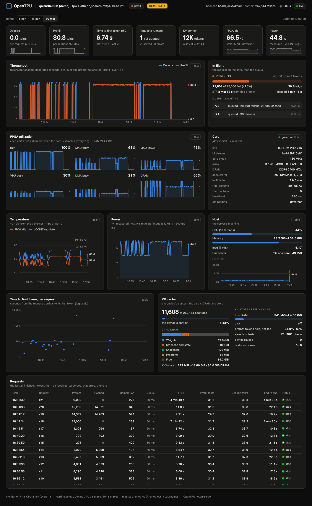

# The dashboard and /metrics: watching an openTPU server

`otpu-serve` (docs/serve.md) and `otpu-serve35` (the 35B on a BCU1525,
`boards/bcu1525/chat35/README.md`) serve a live dashboard at `/` beside the OpenAI-style API,
and Prometheus metrics at `/metrics`. The page is one self-contained file
(`opentpu/serve/dashboard.html`: no CDN, no fonts or scripts from elsewhere); the server renders
nothing, it sends the numbers (`/api/events`, server-sent events, one snapshot a second) and the
browser draws them.



(`otpu-serve --demo`: simulated requests and card, every number marked DEMO DATA.)

## Start it

```sh
# on the card host, in a terminal that stays (a hangup stops the server and puts the card in SAFE)
otpu-serve35                                    # http://127.0.0.1:8000/v1, the dashboard at http://127.0.0.1:8000/
SERVE35_API_KEY=KEY otpu-serve35 --port 8001    # with a key
otpu-serve35 --host 0.0.0.0                     # every interface (default: this host only)

# any model on the card, the card's telemetry every 2 s (default off for otpu-serve)
otpu-serve --model qwen3 --backend board --telemetry 2

# no model, no card: the page and /metrics over simulated data (labelled DEMO DATA)
otpu-serve --demo --port 8000
```

`otpu-serve35` brings the card up as `otpu-chat35` does (the guard, RUN held), loads the 35B (the
same engine: `chat35.open_engine`, the whole 262,144-token context, prompts layer by layer), and
serves until Ctrl-C or SIGTERM; then the card goes back to SAFE. The port is checked before the
load (a port in use fails at once), but the server listens only once the engine is open: about
a minute of bring-up and half a minute of load, connections refused meanwhile. Its log is
`serve35-<date>/serve.log` under the wrapper's runs directory (shown on the terminal too). Options:
`otpu-serve35 --help` (`--kv-ram-gb`, `--kv-disk-gb` (default 64, under `--kv-dir`,
cut to leave 32 GB free), `--prefix-block`, `--max-running`, `--quantum`,
`--think`, `--no-preserve-thinking`, `--reasoning-parser qwen3`, `--telemetry SEC`, `--no-warm-idle`). The key: `--api-key KEY`, or
`SERVE35_API_KEY` (not in `ps`); an `OTPU_API_KEY` is taken as `SERVE35_API_KEY` (every
`OTPU_*` variable is part of the card image's cache key, so the wrapper clears them).

## Connect

From another machine, forward the port (the server binds 127.0.0.1 by default):

```sh
ssh -L 8000:127.0.0.1:8000 CARD_HOST
# then, on this machine: http://127.0.0.1:8000/  (with a key: http://127.0.0.1:8000/#key=KEY)
```

The key in the page's address after `#` is not sent to the server with the page; the page keeps
it in the tab (sessionStorage) and puts it on its own calls (`?key=` on `/api/events`: a
browser's EventSource sends no headers). Without one in the address, a key prompt opens on the
first 401.

The OpenAI client:

```python
from openai import OpenAI
c = OpenAI(base_url="http://127.0.0.1:8000/v1", api_key="KEY")      # any string without a key
r = c.chat.completions.create(model="qwen36-35b",
                              messages=[{"role": "user", "content": "Hi!"}], max_tokens=200)
print(r.choices[0].message.content, r.usage)
for ch in c.chat.completions.create(model="qwen36-35b", stream=True,
                                    stream_options={"include_usage": True},
                                    messages=[{"role": "user", "content": "Count to 10."}]):
    print(ch.choices[0].delta.content if ch.choices else ch.usage, end="", flush=True)
```

curl:

```sh
curl -s http://127.0.0.1:8000/v1/models                      # max_model_len 262144
curl -s http://127.0.0.1:8000/v1/chat/completions -H 'Content-Type: application/json' \
  -d '{"model": "qwen36-35b", "messages": [{"role": "user", "content": "Hi!"}], "max_tokens": 64}'
curl -sN http://127.0.0.1:8000/v1/chat/completions -H 'Content-Type: application/json' \
  -d '{"model": "qwen36-35b", "stream": true, "stream_options": {"include_usage": true},
       "messages": [{"role": "user", "content": "Hi!"}]}'
curl -s http://127.0.0.1:8000/metrics                          # Prometheus
curl -s http://127.0.0.1:8000/api/stats | python3 -m json.tool  # the dashboard's snapshot
# with a key: -H 'Authorization: Bearer KEY' (or ?key=KEY on /metrics and /api/*)
```

## The panels

Every value comes from the server or the card; one the server cannot read shows `n/a` (a card
the simulators do not have, a BMC without power readings, no sample yet), never a made-up
number. Charts span the range picked at the top (5, 15 or 30 minutes); hovering one shows its
values at that time, and each chart's Table button shows its numbers as a table.

| Panel | What it shows | From |
|---|---|---|
| Top bar | the model and its weights' formats, the state (idle, prefill, decode, busy), a pill while program saves are off (below), the backend, context, how far the warm reaches, uptime; the stream's state (live, reconnecting) | the monitor |
| Decode, Prefill | tokens generated per second over the last 5 s; prompt tokens fed per second (over 15 s; the prompt in flight's own rate while it is fed) | the worker's counters, every second |
| TTFT p50 | the median time to the first token of the last 50 requests (p90 under it) | the requests' records |
| Requests running | running and queued now; served, errors | the worker's queue |
| KV context | the device context's positions of the model's (262,144 on the 35B) | the engine's position |
| FPGA die, Power | the die's temperature (the governor's reading) against its 85 °C limit; the power | the card's sampler |
| Throughput | decode and prefill tok/s over time | as the tiles |
| In flight | the request on the card: its prompt's tokens fed of its total, the rate and the ETA (from this prompt's rate, or the recent prompts' before its first part lands), or its decode (tokens, tok/s, TTFT); then the queue (each request's state: prefill, decode, paused between turns, queued) | the worker |
| FPGA utilization | each unit's busy share between two samples: RUNNING (the core), MXU busy, MXU MACs, VPU, DMA, DRAM (the channels' busy share; GB/s beside it), now and its peak over the range; each sample a column from the one before (a sample is a share of the time since the last), so a series of samples further apart than the line's gap still shows; the subtitle says so when samples have come more than 1.5 intervals apart (the sampler's spacing, `monitor.card_spacing_max_s`) | the card's counters (smi's SNAP deltas) |
| Card | the bitstream (build, core clock, D, MCOLS, LANES, DDR rate), PCIe link, the governor's state (RUN / SAFE), DIMMs on, trip and resume temperatures (to 0.1 °C), its heartbeat; thermal trips: the governor's TRIPS [15:0], the thermal stops since its reset (the die, the alarms, the regulator, a reading gone), never the host's SAFE, with the heartbeat's stops [31:16] beside it when there are any; "last stop" in RUN, "stopped by" in SAFE: STATUS's causes, sticky until a CLEAR, so in RUN they are the previous stop's (a host SAFE at the last session's end reads "host SAFE" there, not as a trip) | smi |
| Temperature | a chart a card on two cards: the FPGA die (the governor's reading; the SYSMON register's only when the governor's is gone) and the VCCINT regulator's hottest (the BMC watch), with the 85 °C limit and the governor's trip | smi |
| Fan control | each fan's die, regulator, duty and integral, and fields for its die target, kp, ki and kd (`POST /api/fan_gains`: fan_pid takes them at its next step, docs/bcu1525.md section 15); the panel shows what fan_pid reports in effect, not what was sent; hidden on a host without fan_pid's status files (`OTPU_FAN_DIR`) | fan_pid's status files |
| Power | on the BCU1525 the BMC's reading of the LTC3884's READ_PIN, labelled unverified: the input through that controller's sense resistor, a lower bound of VCCINT's input (UG1268's VCCINT has two LTC3874 slaves beside it, off PMBus), never checked against a meter (below); Vivado's estimate beside it when there is one, else the estimate alone, labelled so | smi |
| Host | the host's CPU, memory and load; the server's own CPU and memory | /proc (psutil elsewhere) |
| Time to first token, per request | each finished request's TTFT (log scale; an error or an abort in its status colour); hover: its prompt, cached tokens, prefill rate | the requests' records |
| KV cache | the device context; the card's DRAM map (the image, the weights, the KV capacity and what is used, snapshots, programs, free); the KV store (host RAM and disk used of their limits, saved contexts, hits and misses); the prefix cache, with the shared prefixes restored (docs/serve.md "Prefixes for other conversations") | the engine, the runner's status, the store |
| Requests | the last 50 finished: prompt, cached and fed tokens, completion, queue time, TTFT, prefill and decode tok/s, end to end, turns and swaps (the context saved and written back between them), the finish; hovering a TTFT: where it went (queue, and of it an idle save's wait; the context switch: save, restore, rollback; the prompt and its snapshot) | the requests' records |
| Footer | the monitor's own cost: CPU a tick, the card sampler's CPU a sample | the monitor |

## Program saves

`progcache._store` and `waits.entries` skip a write that would leave under `progcache.free_floor()`
(4 GiB, `OTPU_PROG_CACHE_FREE_GB`) free on the disk, without a word. A long prompt then compiles and computes each position's
programs and wait entries on every pass: on the two-card 35B a 512-token chunk takes 30-47 s
against 8-11 s with the files on disk, the card about 14 % busy and one host core at 100 %. So the
server says so (`opentpu/serve/progstate.py`; it only reads, and `opentpu/serve` is outside
`progcache.source()`, so no key moves):

- At its start, two lines: `program saves on` or `program saves OFF` with the free MiB and the
  floor, and how far a prompt's runs are on disk: `through 51,200 of 131,072 tokens (bucket
  200 of 512, 4 slots, sampled in 2.48 s)`. The walk checks each bucket's last layer's runs in
  every slot (a dense model's prefill: its fit, and its largest and 1-row runs), then those
  programs' wait entries on about 32 of the buckets: a sample of a warm, not a proof of every file
  (0.8-2.5 s over a 374,385-file cache on a build host). None on an engine with neither.
- On the dashboard: a red pill in the top bar while saves are off, with how far under the floor
  and the wait entries computed in the last minute (a chunk's 328 on the two-card 35B); `warm` beside
  the context.
- In `/v1/stats` and `/api/stats`: `prog_cache` (`saving`, `free_bytes`, `floor_bytes`,
  `under_floor_bytes`, programs compiled and written, entries computed and read and their seconds; the
  snapshot adds `entries_last_min`, `entries_s_last_min`), and `warm` with the server's facts.
  `/metrics`: below.

To warm a tree, see `warm35x2.py`; a copy of files into the cache works under the floor.

## Routes

| Route | |
|---|---|
| `GET /` (`/dashboard`) | the page (it holds no data: open without the key) |
| `GET /api/stats` | the last snapshot as JSON (`?history=1`: with the 30 minutes of series) |
| `GET /api/events` | server-sent events: `hello` (the snapshot with its series and the recent requests), then a `tick` a second (`recent` in it when a request ended since the last); a comment every 15 s without one; `retry: 3000` |
| `GET /metrics` | Prometheus' text format (version 0.0.4) |

The snapshot's keys (`v` 1): `server` (model, uptime, cap, state, backend, weights), `queue`
(running, waiting, items), `inflight`, `throughput`, `latency` (TTFT p50 / p90, end to end,
decode and prefill tok/s medians), `requests` (totals by finish), `kv` (positions, cap, usage,
store, prefix cache, saves, restores, the DRAM map), `card` (the compact smi sample: `null` with
`card_note` saying why), `host`, `monitor` (its cost), `point` and `card_point` (the series'
newest), `recent`.

## Prometheus

vLLM's names (prefix `vllm:`, label `model_name`) where they mean the same here, `otpu:` for the
card, the store and the host. A value the server does not have is left out (no sample), never
a zero.

| Name | Kind | |
|---|---|---|
| `vllm:num_requests_running`, `vllm:num_requests_waiting` | gauge | requests in turns on the device; queued |
| `vllm:kv_cache_usage_perc` | gauge | the device context's positions over the model's context (one sequence) |
| `vllm:prompt_tokens_total`, `vllm:generation_tokens_total` | counter | |
| `vllm:request_success_total{finished_reason}` | counter | stop, length, abort, error |
| `vllm:prefix_cache_queries_total`, `vllm:prefix_cache_hits_total` | counter | prompt tokens looked up; those the device or the store held |
| `otpu:prefix_entry_hits_total`, `otpu:prefix_entry_hit_tokens_total` | counter | restores of a prompt's prefix kept as it was fed (another conversation's system prompt); their tokens |
| `otpu:prefill_device_runs_total` | counter | device runs the host started to feed prompts (a layer loop's runs in a bucket, CHAT35_LOOP: one); none from a worker that does not count them |
| `vllm:time_to_first_token_seconds`, `vllm:e2e_request_latency_seconds`, `vllm:time_per_output_token_seconds`, `vllm:request_queue_time_seconds`, `vllm:request_prefill_time_seconds`, `vllm:request_decode_time_seconds` | histogram | vLLM's buckets (TTFT's past 160 s, for a long prompt on the card) |
| `vllm:request_prompt_tokens`, `vllm:request_generation_tokens` | histogram | tokens per request |
| `otpu:decode_tokens_per_second`, `otpu:prefill_tokens_per_second` | gauge | as the tiles |
| `otpu:prompt_progress_tokens`, `otpu:prompt_remaining_tokens` | gauge | the prompt in flight |
| `otpu:kv_positions_used`, `otpu:kv_positions_capacity` | gauge | |
| `otpu:kv_store_bytes{tier}` | gauge | ram, disk |
| `otpu:card_up`, `otpu:governor_run` | gauge | the accelerator answers; the governor in RUN |
| `otpu:die_temp_celsius`, `otpu:regulator_temp_celsius` | gauge | |
| `otpu:power_watts{source}` | gauge | measured (the BMC: on the BCU1525 the LTC3884's READ_PIN, a lower bound of VCCINT's input) or estimate |
| `otpu:utilization_ratio{unit}` | gauge | RUNNING, MXU_BUSY, MXU_MAC, VPU_BUSY, QNT_BUSY, DMA_BUSY, DRAM |
| `otpu:dram_bandwidth_bytes_per_second{dir}` | gauge | read, write |
| `otpu:host_cpu_ratio`, `otpu:host_memory_used_bytes`, `otpu:process_cpu_ratio` | gauge | |
| `otpu:uptime_seconds` | gauge | |
| `otpu:prog_cache_saving`, `otpu:prog_cache_free_bytes`, `otpu:prog_cache_floor_bytes` | gauge | the program cache saves (0: under the floor); no sample without a disk cache |
| `otpu:programs_compiled_total`, `otpu:programs_written_total` | counter | this process's |
| `otpu:wait_entries_computed_total`, `otpu:wait_entries_compute_seconds_total` | counter | not found in memory or on disk (with a compile pool its reads count too; its seconds do not) |
| `otpu:prog_cache_warm_tokens` | gauge | a prompt's layer runs on disk through this many tokens, at the start |

## The card's telemetry

`opentpu/serve/telemetry.py`'s CardSampler calls `smi.query` (otpu-smi's own reads) on a thread
of its own every `--telemetry` seconds (2 on otpu-serve35; at least 0.5), on its own register
transport (XdmaTransport without DMA, as otpu-smi beside a chat):

- the die is smi's default: the governor's reading, the SYSMON's register only once smi says
  the governor's is gone. Never `--sysmon` (an AXI read of the SYSMON's DRP registers can stop
  the governor's temperature bus) and no SYSMON reads of its own (tests check no read reaches
  the SYSMON's range while the governor's is valid, and no register write);
- the BMC: a bridge with the watch (BMC2) is read from its registers, no session; one without
  it (BMC1) needs a session, under bmc.py's lock that fan_pid shares, at most every 10 s (the
  last reading carried with its age between them);
- the I2C buses are not read (no PMBus on the BCU1525; `--telemetry-i2c` reads them);
- utilization is the counters' change between two samples (the first sample has none).

The monitor's block of `/api/stats` has the sampler's spacing and duration (`card_spacing_s`,
`card_spacing_max_s`, `card_took_s`, `card_took_max_s`): samples further apart than the
interval are a sample that took long (a BMC session, a register read waiting) or the thread
starved.

### What the power reads

`smi.watch_power` on the BCU1525: the BMC watch's W_PIN, the fabric's own read of the
LTC3884 at 0x5B (`otpu_bmc_watch.sv`: command 0x97 READ_PIN, not paged, one value for both
pages), LINEAR11 (the decoder that gives VIN its 11.98 V); a BMC1 session reads the same
command. The command and its scaling are right; what it
covers is the question. READ_PIN is VIN x IIN through the LTC3884's input sense resistor
(docs/bcu1525.md section 13); UG1268's VCCINT is the LTC3884's two phases and two LTC3874
slaves that are not on PMBus, so the reading is a lower bound of VCCINT's input, not all of it,
and on the card it has read 3.9 W idle and 4.3 W in decode against image F's vectorless 13.4 W on
chip (UG1268 puts VCCINT's current at the LTC3884's two phases times three: 4.3 W x 3 = 12.9 W, a
hypothesis). Until a session compares it (READ_PIN against the pages' POUT and IOUT x VOUT, READ_IIN
against ICHIP and the sense resistor's value, a wall meter idle against decode), the page and
`/metrics` call it unverified; smi is unchanged.

Nothing here is on a request's path: the worker never waits for the sampler or the monitor
(a test holds the sampler inside a register read while a chat completion, `/api/stats` and
`/metrics` are served); a sample that fails is told in the next snapshot (`card_error`, the
page's Card panel) and the sampler goes on.

The monitor's thread (`opentpu/serve/metrics.py`) builds one snapshot a second from the
worker's counters and queue (no engine call), the store's usage and the sampler's last sample,
and hands it to every `/api/events` stream. Each request's record (queue time, TTFT, prefill,
decode, tokens, turns, swaps, the finish) is queued by the worker as it ends and folded on the
monitor's thread.

## Its cost

Measured on a laptop (2026-11-03) on the ISA simulator with the serve tests' tiny Qwen3 (the
board-sim backend is the Verilator board model, an RTL simulation, not run there): a
128-token request's turn over its tokens (the device's loop gives them in runs), with nothing
attached ("off"), with the defaults (the monitor every 1 s, the sampler every 2 s on a FakeBcu,
one dashboard client on `/api/events` through curl), and at 20 times those rates (the monitor
every 0.05 s, the sampler every 0.1 s), in ABBA order over 6 repetitions of 4 requests each:

| | per token (median of 24) | IQR | vs off, per repetition (median; range) |
|---|---|---|---|
| off | 20.74 ms | 20.36-21.04 | |
| defaults | 20.84 ms | 20.52-21.02 | +0.0% (-6.3 .. +3.9%) |
| 20x the rates | 21.30 ms | 20.54-21.94 | +2.6% (-3.4 .. +6.9%) |

At the defaults the difference is inside the run-to-run spread; at 20 times the rates it shows
(+2.6%), which bounds the defaults' cost near +0.13%. Their CPU: the monitor 0.29 ms a tick
(0.03% of a core at 1 s), the sampler 0.66 ms a sample (81 register reads on the fake card; 0.03%
at 2 s), a tick's snapshot 1.4 KB of JSON (8 us to encode for each `/api/events` client; ~10 KB
when it carries the recent table). On the card each register read is a 4-byte read of the user
BAR, not under the DMA lock: no wait for the worker's transfers either way. The page's footer
shows the server's own numbers live.

## The 35B's contexts between requests

One sequence: requests run in turns (`--max-running 4`, `--quantum 32` tokens a turn while
others wait), each context saved to the KV store in host RAM when another request takes the
device and written back for its next turn; a chat's next turn feeds only its new tokens.
On the 35B a context is its DeltaNet layers' states (ST16) and convolution windows and its
attention layers' KV pages (about 0.6 GB for a 28k-token context).

On the ISA simulator with a tiny Qwen3.5-MoE on the 35B's image configuration
(`bcu1525-wg:bhw16`: Image.high, the bank-half window, ST16 states), resident, prompts layer
by layer (`tests/test_serve35.py`), two conversations at once in turns of 4 tokens save and
restore their contexts through a staging area and give their fresh runs' greedy tokens; the
next turn feeds only its new tokens. That test found a bug, fixed here: kvio's staging area
began past the program area and was bounded only by the DRAM's end, and on the 35B's image
(Image.high) it overlapped the DeltaNet mixers' weights at `qwen3.area_limit` (`low_top`); it now
ends there (`kvio.staging_area`). The card has not run it yet: the first card session checks a
second conversation between two turns of the first (its `swaps` and the store's `restores` in
the Requests panel, the next turn's cached tokens in its usage).

## Tests

- `tests/test_serve_dashboard.py`: the page (self-contained), `/metrics` parsed line by line
  (every sample after its TYPE, counters `_total`, histograms cumulative with `+Inf` = count,
  `model_name` on every sample), `/api/stats`' schema with the fake BCU's governor die, BMC power
  and utilization, `/api/events` (hello, ticks, `recent` after a request), the key (Bearer,
  `?key=` only on `/metrics` and `/api/*`, the request log without it), the chat stream's SSE as
  OpenAI's clients read it and the `openai` package's client when installed, n/a (no card, a
  card without the governor or BMC, a SAFE card, a card that fails), a sampler stuck in a
  register read not stalling a request, a prompt's progress and ETA, `--demo`; the
  utilization panels' keys against the card's counters as smi names them, the governor's
  figures (trip and resume to 0.1 °C, thermal trips apart from a host SAFE), the power's
  label, the page in the wheel's package data.
- `tests/test_serve35.py`: the 35B's path on the ISA simulator (above); a chat's reply start
  on that image as a snapshot (its area apart from kvio's staging), the next turn rolled back
  to it, the idle save staged into the store and a turn restored from it after another
  conversation; chat35's setup as a function (`main` and `open_engine` share it; otpu-chat's
  arguments unchanged).
